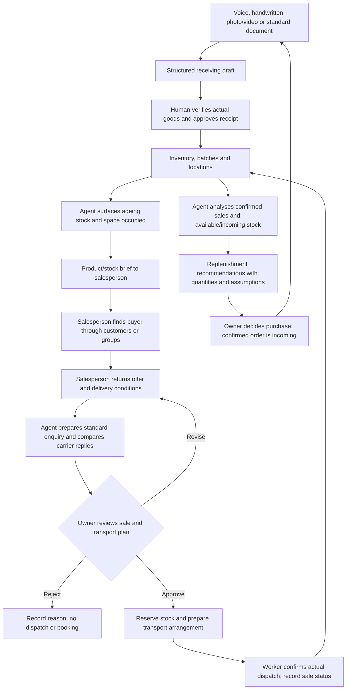

# Current direction and revision boundary

**User-confirmed direction, C:** WareOrb is a warehouse-operations assistant
that helps a small merchant capture stock, notice ageing goods, put those goods
in front of sales staff, coordinate delivery quotes after a buyer is found,
obtain owner approval, record dispatch and improve replenishment decisions.
The user clarified this complete workflow and confirmed Codex's restatement.
This establishes product intent, not measured adoption or impact.
[^team-workflow-clarification]

**Revision ID: `2026-10-23-complete-warehouse-workflow`.** This is the current
proposal. The existing filename is retained to preserve links. The earlier
capacity-reallocation version is preserved at commit `67111f4`; the
[earlier review](wareorb-capacity-review.md) evaluates that narrower version,
not this clarification. Its findings may inform this design, but its proposed
cuts are not user-approved changes to the complete product.
[^prior-capacity-version][^prior-capacity-review]

The difference is substantive: receiving remains part of the product; sales
staff explicitly find buyers; clearance is ordinary work to move ageing stock;
replenishment advice is a continuing analysis of recorded sales, not a profit
condition imposed on every clearance. The user has requested this documentation
update and a new review prompt. No application implementation or final
cross-candidate selection is implied.[^team-workflow-clarification]

**Evidence:** A denotes official/company statements, B external domain
guidance, and C unvalidated product proposals. User statements are direct
evidence of intent, not market validation. Sections labelled **Design
recommendation** specify Codex's proposed controls or examples rather than
additional requirements already chosen by the user. The
[source register](../sources/wareorb-capacity-reallocation-sources.md) preserves
earlier source IDs and records the clarification.

# 1. The problem and product promise

**C, team hypothesis:** merchants can record stock without consistently turning
those records into action. Some goods sit unsold, occupy useful positions and
receive little sales attention. Even without a direct accounting loss, that
can reduce the space available for better-performing goods. Staff then repeat
cargo information across messages, compare inconsistent transport replies and
reconstruct what sold before deciding what to buy next.
[^team-workflow-clarification][^team-capacity-proposal]

**Proposed promise:** make the stock record useful throughout daily work:
capture it where it enters, surface goods needing attention, help sales and
transport handoffs, and learn from confirmed sales and movements.

The product is not defined by a requirement that a particular clearance plus
a replacement purchase must generate positive incremental profit. A merchant
may accept a clearance for recovery, space, age, condition or service reasons.
If the owner wants a keep-versus-clear scenario, it is supporting analysis;
the owner still decides. Claimed future gains require explicit evidence and
assumptions.[^team-workflow-clarification]

# 2. The complete workflow

These are the **user's intended product stages**. Controls within the stages
are design recommendations unless stated otherwise.

| Stage | What happens | Human responsibility | Recorded result |
|---|---|---|---|
| 1. Capture a receipt | Voice input, visual reading of handwritten notes in photos/video, or entry/import of standard business documents produces a structured draft | Staff correct ambiguous items, quantities and units | Original input and editable draft lines |
| 2. Review and receive | The receipt is checked and approved before posting inventory | Authorised staff verify the actual goods, counts, condition and location | Approved receipt and stock/location records |
| 3. Surface ageing stock | Agent examines stock age, sales/movement history and occupied positions | Merchant sets or reviews what deserves attention | Explainable attention list, not an automatic disposal order |
| 4. Hand off to sales | Agent prepares useful product/stock information for sales staff | Human salespeople contact customers and use their groups/channels to find buyers | Assigned sales task and current customer interest |
| 5. Return buyer information | Salesperson records the interested buyer, quantity, offered price, destination and delivery requirements | Salesperson confirms the buyer's actual request | Offer/delivery brief linked to the relevant stock |
| 6. Enquire and compare transport | Agent combines cargo records and buyer conditions into one consistent request, then structures carrier replies | Merchant authorises the enquiry scope; carriers confirm services and prices | Comparable quotes, exclusions and missing information |
| 7. Review and approve | Agent prepares the sale/transport proposal and its costs for the boss | Owner approves, edits, defers or rejects | Versioned decision, eligible stock reservation and proposed arrangement |
| 8. Confirm dispatch | The approved goods are physically handed over/collected | Warehouse worker confirms actual departure; sales/commercial status is also recorded | Stock decreases, positions become free, sale/movement log updates |
| 9. Analyse and advise replenishment | Agent analyses recorded sales, availability, ageing goods and incoming stock | Owner reviews which products and quantities to replenish | Explainable purchase recommendation; no automatic purchase commitment |

Stages 3 and 9 can run periodically or on relevant stock/sales changes. They
do not wait for a single clearance to complete. A current offer can enter at
stage 5 too; this does not replace the proactive ageing-stock-to-sales path.
[^team-workflow-clarification]

The last purchase/receiving connection describes how the operating cycle can
continue, not authorisation for automatic ordering or a separate purchasing
platform. Transport and purchase channels in a competition prototype may be
labelled simulations.[^domain2]

# 3. Multimodal receiving is retained

**User requirement:** retain receiving entry rather than treating every input
as an already-populated spreadsheet. Voice, handwriting/visual input and
standard documents are alternative capture routes into the same draft and
human-review process.[^team-workflow-clarification]

**Design recommendation:**

* Keep the original document, selected video frames or voice transcript linked
  to extracted fields. A video is a way to capture readable evidence, not
  proof that all physical goods or dimensions have been detected.
* Ask about uncertain item aliases, variants, units, quantities and duplicate
  documents. Preserve staff corrections and their source.
* Confirm the physical receipt, usable condition and put-away location before
  posting. OCR or speech recognition alone does not establish physical stock.
* Reuse known catalogue dimensions and weight; capture missing packed size or
  batch-specific exceptions explicitly. Do not infer them without evidence.
* Standard documents may be typed, imported or extracted; a particular file
  format, model/provider or live-video architecture has not been selected.

The earlier received concept and receiving plan remain relevant design history,
but older read-only voice guidance must not be mistaken for a ban on the newly
requested **voice-to-draft receiving**. Consequential posting still needs
authorised confirmation.[^original-concept][^receiving-plan]

# 4. Ageing-stock detection and the sales handoff

**User requirement:** identify stock that has remained unsold for a long time,
show its warehouse pressure and give sales staff the information needed to
promote it through their existing contacts and groups.
[^team-workflow-clarification]

**Design recommendation:** distinguish the age of a particular batch from the
age of the product model. Explain a flag using receipt date, remaining
quantity, recent confirmed sales and positions occupied. The merchant sets
age/attention rules; no default number of days or mandatory discount has been
agreed. Account for reservations, damage, displays, seasonality and incomplete
history before calling goods eligible for a clearance sale.

The sales brief can contain product/variant, photos, condition, available
quantity, age, pickup location and owner-set price guidance where available.
Salespeople choose whom to approach and which groups to use. They return the
buyer's request and update whether interest is tentative or confirmed. Agent
support may prepare/export the brief or create an internal task; the delivery
channel is an implementation choice, not permission for unrestricted automated
group posting.

Finding a buyer is therefore an explicit **human sales activity**, not a
missing autonomous marketplace feature. Its success rate, frequency and effort
remain to be validated. Lack of a buyer must leave the stock in follow-up,
not create fictitious proceeds or a transport booking.

# 5. Transport request, quotation and owner review

**User requirement:** combine stored cargo information and customer delivery
information, enquire with approximately three or four cooperating
drivers/carriers, and prepare the result for owner review.
[^team-capacity-proposal][^team-workflow-clarification]

| Field | Starting source | Check before commitment |
|---|---|---|
| SKU/variant, quantity, weight, dimensions, packaging and pickup location | Inventory/catalogue and selected batch | Warehouse confirms this actual consignment |
| Destination, floor/lift access, delivery window and requested unloading | Buyer information returned by salesperson | Salesperson confirms missing or contradictory conditions |
| Vehicle fit, service area, collection time, staffing and exclusions | Carrier reply | Carrier confirms the requested service can be provided |
| Complete charges, validity, insurance/compensation and cancellation terms | Carrier quote | Requested cover is not proof of agreed cover; normalise currencies/units and resolve gaps |

Weight and distance are useful inputs but do not alone define a comparable
bulky-goods service. Preserve original replies. Missing unloading, expired
quotes, additional fees and unsuitable service remain visible. Propose the
lowest complete cost among feasible services while showing timing and terms;
the owner may select a trusted carrier with a recorded reason.

The owner sees the buyer, goods, offered sale price, full quoted transport and
other relevant sale costs, net recovery, proposed collection and space to be
released. These are not automatically an accounting profit calculation. An
optional keep/clear or replacement scenario may help explain a trade-off, but
it is not a prerequisite for every sale and does not impose an agent-created
profit veto.[^team-workflow-clarification]

# 6. Approval, dispatch and a reliable sales record

**Design recommendation:** approval binds to the stock, buyer, quantity,
price, delivery conditions and carrier quote actually reviewed. Material
changes require renewed review. Reserve the approved quantity so another
salesperson cannot commit it again. Rejecting a proposal records the reason;
it does not create a booking or stock movement.

An approved proposal is not a completed sale or physical dispatch. Record
commercial acceptance/cancellation separately from actual movement. A warehouse
worker confirms the collected quantities and actual departure before reducing
on-hand stock or releasing positions. A transfer is not revenue; a customer
return is not a new receipt from a supplier. No payment gateway is needed to
record these operational facts.

Handle cancelled buyers, collection delays, changed charges and partial
collections explicitly. Release reservations on the appropriate cancellation,
retain occupancy when the goods have not left, and avoid duplicate movements.
Log actor, timestamp, source/decision version and reason for corrections. The
particular staffing arrangement for dispatch confirmation remains an owner
choice; warehouse confirmation is the recommended default.

# 7. Continuing warehouse analysis and replenishment advice

**User requirement:** use the information accumulated by the system to identify
fast sellers and suggest what and how much to purchase, with an explanation of
the expected operational improvement.[^team-workflow-clarification]

**Design recommendation:** use confirmed net sales and correctly classified
outbound movements, not enquiries, quotations or approvals counted as sales.
Compare the selected period, returns, stockouts and promotions, and show the
quality/freshness of the evidence. Consider current unreserved sellable stock,
confirmed incoming quantities, lead time, usable space and purchasing cash.
Sales volume alone does not establish the best product or a guaranteed gain.

The initial quantity rule can be a transparent merchant-set coverage target
less relevant available and incoming stock, bounded by feasible space and
budget. This is an example rule, not an approved or validated forecasting
method. Insufficient records should produce an explanation or an editable
assumption instead of a fabricated demand estimate.

Replenishment advice is a separate owner decision informed by the entire
warehouse. It may benefit from space released by several sales and can also
arise without any clearance. Expected improvements may concern availability,
turnover, ageing-stock exposure or contribution; show the metric and
assumptions. If a scenario claims incremental profit specifically caused by
clearing a batch, compare feasible alternatives, arrival times and demand that
would otherwise be lost or deferred. Do not count all later sales as a
clearance benefit by default, or treat a historical purchase cost as a new
payment caused by today's decision.[^acca-relevant-costs]

# 8. A synthetic operating example

**All names, ages, quantities, amounts and rules below are illustrative, not
records from a real merchant or measured gains.**

1. **Receive:** staff speak or capture a handwritten/standard note for four
   dining chairs. The agent drafts the lines; a person verifies all four,
   corrects any extraction and confirms receipt and location.
2. **Notice:** a different, previously received sofa batch has four units
   occupying positions A1 and A2, two per position. Its recorded age is 120
   days with no sales in the selected recent window. The agent flags it for
   attention; these are seeded historical records, not newly received goods
   instantly labelled old.
3. **Sell:** the agent prepares its brief. A salesperson approaches existing
   contacts/groups and returns an interested buyer's offer of RM1,200 for two
   units, with destination/access requirements.
4. **Quote:** three synthetic replies are RM280 including required unloading,
   RM220 excluding it, and RM300 with expired validity. The agent flags the
   latter two and presents the comparable eligible option. Assume RM20 packing
   cost and merchant-paid freight: net recovery is RM900 before historical
   stock cost, not RM900 profit.
5. **Approve and dispatch:** the owner approves; two units are reserved while
   all four remain physically on hand. Warehouse staff confirm collection from
   A1. Only then does on-hand fall to two and A1 become free; A2 is still
   occupied. The sale and movement are linked and logged.
6. **Advise:** another sofa SKU has 12 confirmed net sales in 30 days, five
   on hand, two reserved and two confirmed incoming. Against an illustrative
   owner-set target of nine available/incoming units, a simple rule suggests
   four more: 9 - (5 - 2) - 2 = 4. The owner still checks timing, cash and fit.
   This replenishment suggestion does not retroactively decide whether the
   old-batch sale was allowed.

# 9. Product scope, Excel and reuse

**The complete product definition retains all workflow stages.** A competition
implementation may prioritise depth or simplify interfaces, but must state
which user-requested stages are implemented, simulated or deferred. Do not
silently redefine the whole product as a calculator or quote reader, remove
receiving by default, or require a marketplace.
[^team-workflow-clarification]

| Included in the intended direction | Detail still open |
|---|---|
| Voice/visual/standard receipt capture with human approval | Exact formats, languages, hardware, model/provider and live-video versus captured-frame design |
| Stock, ageing attention list and salesperson handoff | Age thresholds, assignment rules and messaging/export channel |
| Buyer details, carrier comparison and owner approval | Carrier channel, timeout, price limits and commercial policies |
| Reservations, physical dispatch and activity history | Staffing, partial movements and persistence implementation |
| Continuing sales analysis and purchase recommendations | Window, coverage rule, contribution estimates and evaluation method |
| Original warehouse visual/voice experience where useful | Existing capabilities must be verified; no new guarantee of a working scene or extra floor polish |

Excel/POS/accounting imports can coexist with direct receiving capture. Excel
can record and calculate; the adoption hypothesis is less re-entry and fewer
missed handoffs across receiving, sales follow-up, quotes, approval and stock
updates. A capable spreadsheet plus messaging is the fair comparison. Reused
stock fields are not automatically new work, but any additional maintenance
must be measured.

Furniture is the first demonstration segment. Product, batch, dimensions,
locations, movements, delivery requirements and approval settings should be
configurable for independent merchants. Other bulky-goods segments are future
validation targets. No universal cross-industry fit is claimed. The original
warehouse view may show stock/age/assignment/reservation states and actual
release; it must derive from records rather than imply automatic physical
sensing.[^original-concept]

# 10. Orbyte and competition boundaries

**A, official brief:** build a useful SME automation capability for Orbyte's
ecosystem, with connected data, decision logic, human approval and a completed
visible outcome/activity record. Inventory/logistics are eligible areas;
existing HR/admin duplication is excluded. The product need not solve
Orbyte's own internal warehouse problems. Proposed fit is not sponsor approval.
[^domain2]

**C, proposed fit:** WareOrb adds stock, sales-handoff and transport workflows
on top of a shared organisation/role/approval context. Orbyte describes shared
foundations and coexistence with existing records, but its API/ecosystem
direction is not proof of a usable connector. The 21 October workspace
observation is historical. Use labelled simulated roles/adapters until a
supported integration is verified.[^orbyte-platform][^orbyte-faq][^orbyte-workspace]

All competition stock, documents, speech/video examples, buyers, carriers and
sales history must be team-created synthetic data. Transport communication can
be simulated. Human approval does not permit real payment under the brief.
The earlier optional on-chain gateway remains a historical idea; it is not
needed for this clarified workflow and no provider or implementation has been
chosen. Do not add legal/financial advice or statutory filing.[^domain2]

For a future real deployment, propose role-limited access, authorised
recipients, minimum necessary cargo/contact sharing, a stated purpose and an
explicit retention/deletion policy for documents, images/video, voice and
customer data. This is a design proposal, not a claim of PDPA compliance.
Measure reduced entry/follow-up work and record consistency for SDG 8.2/8.3;
any SDG 12 claim needs evidence beyond moving stock. No measured profit,
training reduction or avoided disposal is asserted.[^domain2]

# 11. What the next review must evaluate

The [new review task](wareorb-workflow-review-prompt.md) must assess this
revision ID and read the original clarification below. First restate the whole
workflow, then identify defects in it. Evaluate faithful capture, stock/sales
record quality, useful ageing flags, the human sales handoff, carrier work,
owner controls, continuing replenishment advice, adoption and feasible build
scope. Distinguish full product intent from any recommended smaller demo.

Open decisions include the first merchant, actual frequency and warehouse
constraint, capture accuracy, data upkeep, age/attention rules, salesperson
handoff and outcome reporting, dispatch roles, carrier cooperation and
replenishment assumptions. No commercial benefit is validated. See
[open questions](../open-questions.md) and the source register. This update does
not perform outreach, run a model trial, implement the app, execute a payment
or replace the separate Kenal decision.

# 12. Original user statements, preserved in their source language

The following are the original messages that introduced and refined this
proposal. They are evidence of user intent, not instructions to execute
communications or payments. Speech-like wording, including "Obit" and
"通销款", is retained. The English synthesis interprets these in context as
Orbyte and established fast-selling products.[^team-capacity-proposal]

## Initial proposal

> All right，我现在想到一个改进的项目，就是一个仓储压力的问题。就比如说我留了一个旧款，底下旧款我运到……然后我这时候想进一个新款，我新款会比较赚钱。如果是旧款的情况下哈，我想把旧款，比如说像我在马来西亚的话，我如果运到东马地方，我可能会花很多的钱。然后这时候如果我再进新款，然后新款快卖掉，新款获得的利润跟这旧款亏的钱，如果不能成一个正向的话，agent会否决掉我们这个卖给东马这个人的一个请求。那如果卖给一个西马的人，西马人因为可能就花钱比较运费比较少，然后虽然你卖这个旧款的沙发可能会少亏一点钱，但是你进新款卖的钱，更多补回了这个差价，实际上理论上讲你是赚的。然后其实还有一个第二点，就是我们可以考虑联合进去 agent 去帮我们去支付之前说那个链上网关。OK，链上网关的问题，但是我们没有去真正地支付，因为这个黑客松它要求了就是，黑客松要求就是要有人工 review。我们很简单，我们就是去让 agent 去问司机，我们这个东西你运到这个地方，他要多少钱？然后我们可能会问三四个司机，因为我们需要养这司机的东西，等下才会跟我们合作啊，这都是题外话。OK，然后如果我们去挑这个最少的人，然后去分析进到这个新货，预计会赚多少钱，然后减去这个花费，然后统计一切的花费，然后把这个报表做给老板去看。这是我准备给这个 warehouse 提供了一个新的一个商业价值。你觉得怎么样。

## Follow-up correction and scope question

> 关于第一实际售价、完整运输成本和时间才决定，这个我认可， OK，关于这个第二点，我的想法就是，原本就是我们反驳这个仓库的这个软件，它最大的问题就是库存的时候为什么不能用Excel，还有就是卖出去为什么不能用Excel。OK，那现在我们现在改进的这个问题，就是说我们不一定要用新款来让这个赚钱，我可以通过这个，就是走出去的这个系统，我们就是可以知道哪一些东西卖得比较多，然后我们可以通过这个系统去分析，就是说我们换成那种通销款，会更加赚钱，来让我们这种旧款，来就是让我们旧款卖出去，腾出一些空间给这种通销款。关于第三点我认可，这个我觉得就是入库的时候就有这些数据，货物尺寸、数量、装卸，然后楼层、保险或赔偿责任、提货时间和附加费用这些东西都是客户提供的，然后我们就是说这些数据通过agent 统一，发给司机。第四方案给老板审核。刚刚还有个问题就是我们目前的系统设计太窄了，就是专注于家居的。然后就是还有问题 你觉得我们这个问题就是，要，就是这次比赛，要专注于这次Hackathon的问题，还是要解决这个Obit的问题？我的意思就是我们这个方案的确是能解决到 small business的问题，因为我的判断是这样。但是我觉得可能是没有解决到 Obit 的问题，你知道吗？

## Complete workflow clarification (current intent)

The following clarification controls the current product description. Original
speech-like wording is retained; salespeople finding buyers is the contextual
meaning of the sales handoff.[^team-workflow-clarification]

> 我觉得我们之前对于这种清货的定义实在太严肃了。我的想法一直都是就是让乐乐可以用这个系统更好的去清货的感觉。然后整个流程现在跟你说一下，就是录单，就是进库录单，有的人是手写嘛，有的什么样，我们就保留之前的想法，就是说语音输入，语音输入，然后那种视频识别的手写，然后还有专业的单的录入。然后这些可以用那个视觉还有语音 agent 去录单，入库，然后让人工来审核。然后接下来就是我们说的那种，通过库存检测，就检测到哪一些是旧货。这些旧货它有比较大的那种仓储压力，就存的人员不能说亏钱，也会让我们的空间放不了那种畅销款，导致赚钱的效率没那么高。然后这个 agent 找出来那些长期没有被卖掉的，然后就把这些信息给销售员，让这些销售员去跟别人讲，跟群。就是说他要就是那种丢手都用卖的，就是他等到他这个业务员是找到卖家的信息，返回给这个 agent。这个 agent 去跟库里的那种重量还有那个距离去对比，重量结合这些信息之后发给那种司机，司机给出报价。然后让 agent 去发给老板来审核。然后 agent 再有一个仓库分析，就是因为它会记录那些初步信息嘛，它会记录到那种什么是畅销款，agent 会给出那种进货的建议，说 OK 进这些多少货，进什么货，预计会比较好的一个有一个绩效的增长。我的想法大概是这些，就是整个项目流程。

## Confirmation of the corrected workflow

> 对对，这才是我目前的这种优化方向，知道吗？然后就是说，你之前不是给我整理了一份？你不是之前整理了一份那个，那个叫什么，那个什么完整方案。你能告诉我你的完整方案跟我讲的是一个东西吗？

# Related and sources

* [New review task for the complete workflow](wareorb-workflow-review-prompt.md)
* [Historical review of the narrow capacity version](wareorb-capacity-review.md)
* [WareOrb overview and original concept](wareorb.md)
* [Earlier receiving-focused plan](wareorb-improvement-plan.md)
* [Official Domain 2 record](../competition/domains.md)
* [Source register and access limits](../sources/wareorb-capacity-reallocation-sources.md)

[^team-capacity-proposal]: Two direct user messages in this conversation, 23 October 2026 MYT; preserved in section 12. The subsequent message authorises Markdown documentation and push. Intent only; no measured demand or benefit.
[^capacity-source-register]: Source register for this revision, including access method, date and claim limits.
[^original-concept]: Received concept, kept unchanged; its capabilities and benefits are proposals.
[^receiving-plan]: Earlier advisory receiving-focused plan, 21 October 2026; not rewritten by this revision.
[^domain2]: Complete converted official Domain 2 brief, sections 2-9, read in full during this discussion; rules and platform statements are distinct from this product's proposed fit.
[^orbyte-platform]: Company platform page re-opened 23 October 2026 MYT; shared foundations and ecosystem direction are company claims, not verified connector availability.
[^orbyte-faq]: Company FAQ re-opened 23 October 2026 MYT; existing records typically remain; no WareOrb integration proven.
[^orbyte-workspace]: Historical first-hand workspace observation, 21 October 2026; no new live workspace inspection performed.
[^acca-relevant-costs]: ACCA technical article re-opened 23 October 2026 MYT; future cash-flow differences, sunk costs and opportunities forgone; not evidence of WareOrb's impact.

[^team-workflow-clarification]: Direct user clarification and subsequent confirmation on 23 October 2026 MYT, preserved in section 12; the user then requested correcting the document and preparing a new review prompt. Product intent only, not human source verification or measured benefit.
[^prior-capacity-version]: Earlier full text is preserved in Git at 67111f4; the current document deliberately corrects that narrower framing.
[^prior-capacity-review]: Existing Claude report reviews the earlier commit; preserved unchanged and not represented as a review of this revision.
